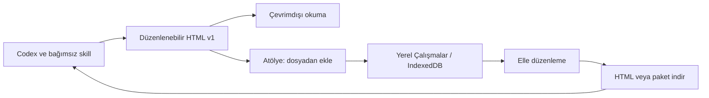

# Bağımsız skill ve Atölye

## Aynı depoda iki ayrı bölüm

- `skills/rtai-newspaper/`: kendi kılavuzları ve Node.js betikleriyle bağımsız üretici. Bu klasör tek başına taşınır; Atölye, React, Vite ve npm bağımlılıkları gerekmez.
- `src/`: web Atölyesi, Çalışmalar ana sayfası, düzenleme, dosya içe/dışa aktarma, okuma ve PDF.
- `.agents/skills/rtai-newspaper/`: bu depoda Codex keşif girişi; bağımsız skill kılavuzuna yönlendirir. Başka bilgisayara kurulacak klasör `skills/rtai-newspaper`.

Ortak dosya sözleşmesini birlikte sürümlemek için şu an tek depo kullanılır; iç içe Git deposu veya submodule kurulmadı. Bağımsız skill ileride ayrı depoya taşınabilir.

## Akış ve dosya sözleşmesi

HTML tek dosyadır. `script#rtai-project[type="application/json"]` içinde `format: "rtai-editable-html"`, `version: 1`, proje ve medya bulunur. Tam yazılar tasarım kutularından ayrıdır. Görsel HTML'de bir kez Base64 olarak taşınır; öğeler medya kimliğine referans verir. Otomatik kayıtta görseller Blob olarak saklanır, proje JSON'una Base64 yazılmaz.

Atölye gelen HTML'i çalıştırmaz veya DOM'a eklemez; tanımlı JSON bölümünü çıkarıp proje/sürüm/sınır/görselleri doğrular. Düzenleme verisi olmayan sıradan HTML reddedilir. Dışa aktarma doğrulanmış modelden yeni bir okuma HTML'i oluşturur. Eski `.rtai.zip` dosyaları da desteklenir.

## Ortak kod ve paketleme

`src/model.ts`, `src/validation.ts`, `src/layout.ts`, `src/html-document.ts` sözleşmenin kaynaklarıdır. `npm run skill:sync` bunları skill'in `scripts/runtime/` klasörüne uygulamadan bağımsız JavaScript olarak üretir; medya/hazır yerleşim yardımcılarını da dahil eder. `npm run build` eşitlemeyi çalıştırır. Paylaşılan kaynak değiştiğinde bu komutu çalıştırın; üretilen çalışma dosyalarını elle değiştirmeyin.

Başka bilgisayarda derleme yapılmaz. Hazır skill yalnızca Node.js yerleşik modüllerini ve kendi dosyalarını kullanır. `npm run skill:bundle -- yeni-skill.zip` taşınabilir arşiv oluşturur; mevcut çıktının üzerine yazmaz.

## Yerel çalışmalar

IndexedDB v2 projeleri kimlikle saklar. Eski tek `current` kaydı çalışma listesine taşınır; görseller atomik yükseltmede proje kapsamına geçirilir. Medya anahtarı `projectId:assetId` olur. Aynı görsel kimliği başka gazeteyi değiştirmez.

Dosyadan eklenen gazete yeni çalışma kimliği alır; mevcut kayıt ezilmez. Sayfa/öğe/yazı kimlikleri korunur. Çalışmalar'a dönüş bekleyen kaydı tamamlar. Ana sayfa oluşturma, açma, ad değiştirme, arama, HTML indirme ve silme sağlar. Kayıt/kota hatasında mevcut kayıtlar korunur; açık çalışma dosya olarak indirilebilir.

Kayıt tarayıcı profili ve origin'e (protokol/alan adı/port) bağlıdır. Aynı origin içindeki farklı yollar aynı veriyi paylaşır. ERP hesabına bağlı veya ortak uzak saklama ve sekmeler arasında çatışma çözümü henüz yoktur. Saklama sınırı `src/storage.ts` içindedir; uzak uygulama ERP mimarisiyle daha sonra tasarlanacak.

## Canlı ve ERP sınırı

Atölye `dist/` olarak statik sunulabilir. Göreli `base: './'` alt yola yerleştirmeyi destekler; yerel aynı origin iframe denemesi vardır. Gerçek ERP adresi, iframe politikası, kimlik doğrulama ve depolama ayrıca doğrulanmalı. Bkz. [statik sunma/gömme](DEPLOYMENT.md).

Otomatik yayınlama, ERP upload endpoint'i ve hesap/bulut altyapısı eklenmedi. Dosya dışa aktarma yayınlama işinden ayrıdır. İleride son düzenlenmiş, doğrulanmış dosya kullanılacak; hedef/yetki/onay akışı kullanıcı mimariyi belirledikten sonra tasarlanacak.
