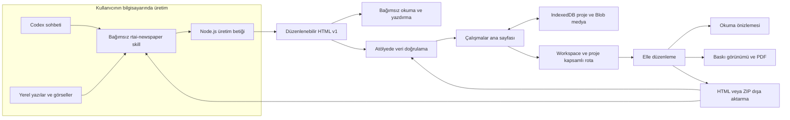
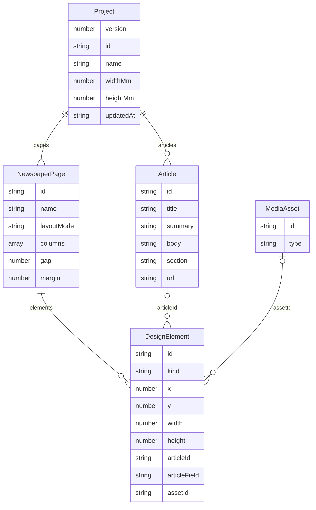
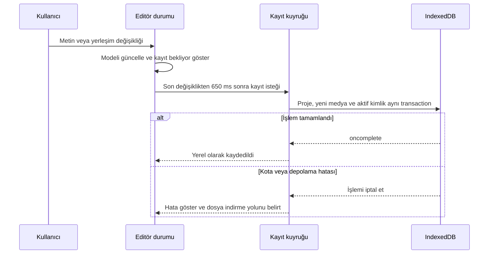
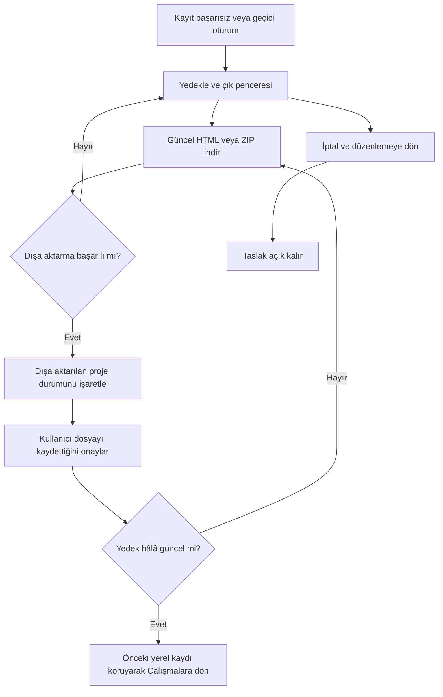
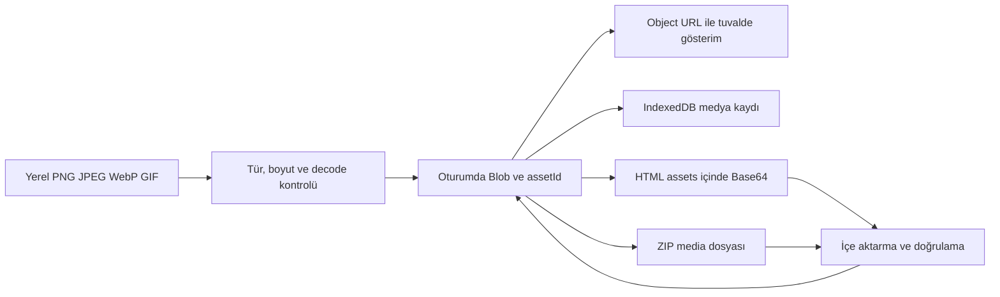
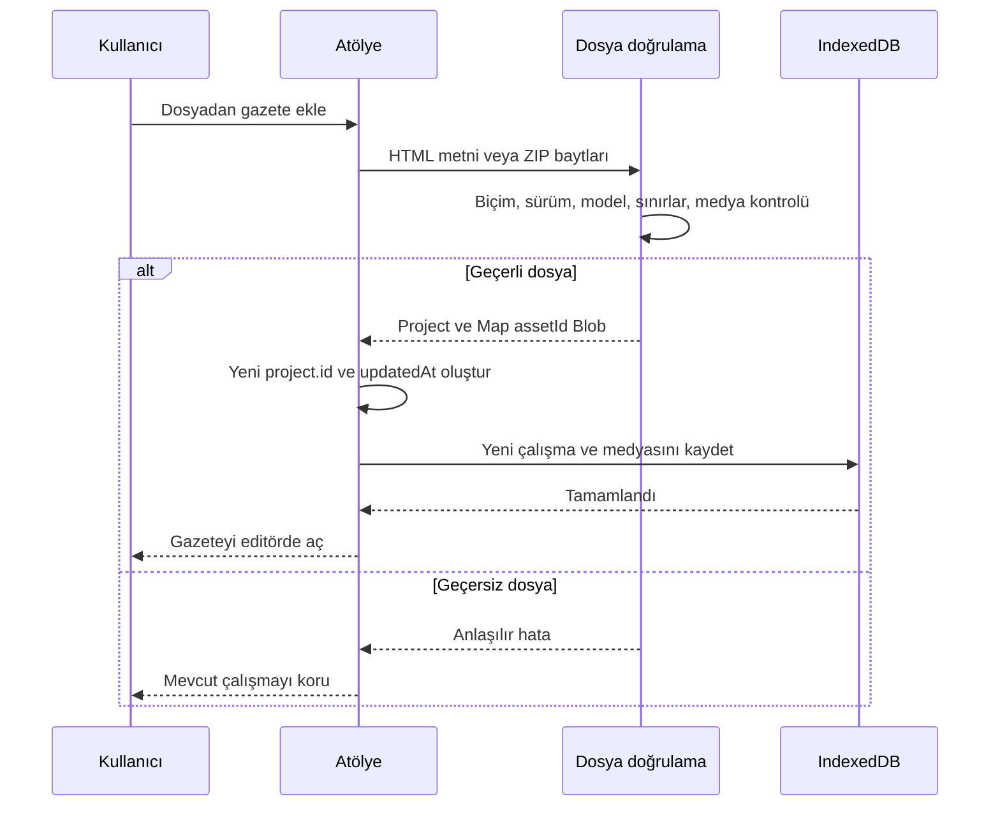
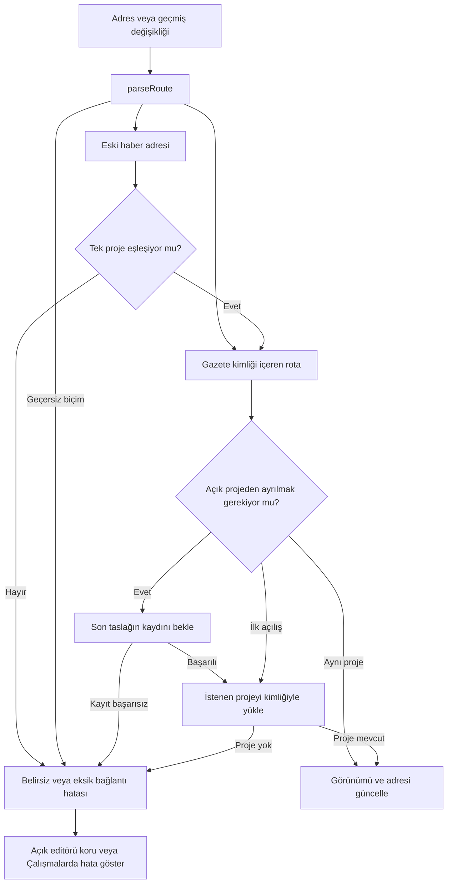
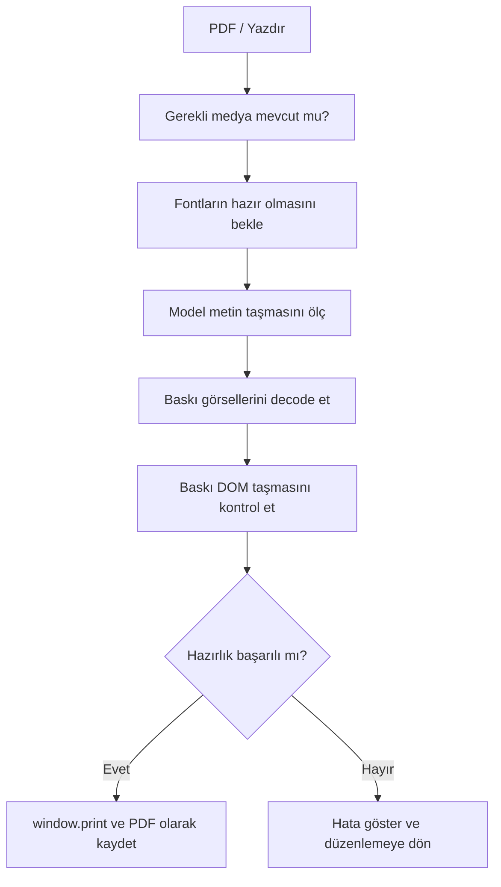

# RTAI Gazete Atölyesi teknik mimarisi ve çalışma rehberi

**Güncelleme:** 13 Ekim 2026 · **Uygulama sürümü:** 0.1.0 · **İncelenen kod:** `e9cf1be`.

RTAI Gazete Atölyesi, gazete sayılarını tarayıcıda düzenleyen bir web uygulaması ile aynı dosya biçimini üreten bağımsız bir Codex skill'inden oluşur. Kullanıcı kendi bilgisayarındaki Codex ile gazeteyi üretir, HTML dosyasını Atölyeye yükler, yerleşimi elle düzenler ve sonucu yeniden HTML veya medya içeren proje paketi olarak indirir. Okuma görünümü ve çok sayfalı PDF hazırlığı bu akışın parçasıdır.

Bu rehber ürünü devralacak geliştirici, kurulumu yapacak kişi ve ileride ERP entegrasyonunu tasarlayacak teknik ekip içindir. Aşağıdaki mimari mevcut kaynak kodunu açıklar. ERP, hesaplar, uzak depolama ve otomatik yayınlama henüz uygulanmamıştır. Son bölümdeki entegrasyon adımları sonraki aşamaya ait karar noktalarıdır.

Son kod güncellemesi gazete kapsamlı haber/okuma bağlantılarını ve hata sonrası devam akışını içerir. Rota yönetimi `Workspace` ve `routes.ts` üzerinden yürütülür; kayıt başarısız olduğunda güncel dosya yedeği ve kullanıcı onayıyla editörden çıkılabilir. Son tamamlanan kontroller 15 birim, 6 CLI ve 25 tarayıcı testidir. İnceleme raporundaki R01, R02 ve R04 kapandı; R03 ve diğer bekleyen maddeler bu rehberde tamamlanmış özellik olarak gösterilmez.

## İçindekiler

1. [Ürün sınırları ve temel kararlar](#ürün-sınırları-ve-temel-kararlar)
2. [Sistem mimarisi](#sistem-mimarisi)
3. [Teknolojiler ve bağımlılıklar](#teknolojiler-ve-bağımlılıklar)
4. [Kod ve modül haritası](#kod-ve-modül-haritası)
5. [Veri modeli ve koordinatlar](#veri-modeli-ve-koordinatlar)
6. [Editör durumu ve etkileşimler](#editör-durumu-ve-etkileşimler)
7. [Kolonlar hizalama ve metin akışı](#kolonlar-hizalama-ve-metin-akışı)
8. [Yerel kayıt ve çalışma alanı](#yerel-kayıt-ve-çalışma-alanı)
9. [Görsellerin yaşam döngüsü](#görsellerin-yaşam-döngüsü)
10. [HTML ve ZIP dosya sözleşmeleri](#html-ve-zip-dosya-sözleşmeleri)
11. [Bağımsız skill ve terminal üretimi](#bağımsız-skill-ve-terminal-üretimi)
12. [Okuma görünümü ve adresler](#okuma-görünümü-ve-adresler)
13. [PDF ve baskı hattı](#pdf-ve-baskı-hattı)
14. [Güvenlik ve doğrulama sınırları](#güvenlik-ve-doğrulama-sınırları)
15. [Testler ve doğrulanmış davranışlar](#testler-ve-doğrulanmış-davranışlar)
16. [Kurulum geliştirme ve statik sunma](#kurulum-geliştirme-ve-statik-sunma)
17. [ERP için sonraki kararlar](#erp-için-sonraki-kararlar)
18. [Bakım ve bilinen sınırlamalar](#bakım-ve-bilinen-sınırlamalar)

Mermaid şemaları GitHub gibi destekleyen Markdown görüntüleyicilerinde çizim olarak görünür. Desteklemeyen görüntüleyicilerde aynı bloklar metin olarak okunabilir.

## Ürün sınırları ve temel kararlar

| Alan | Mevcut yaklaşım | Pratik sonucu |
| --- | --- | --- |
| Gazete üretimi | Codex'in yerel skill ve Node.js betiklerini kullanması | Atölye içinde GPT API çağrısı, API anahtarı veya gömülü Codex gerekmez. |
| Elle düzenleme | DOM üzerinde mutlak konumlu, ayrı tasarım öğeleri | Gazete tek bir resme dönüştürülmez; metin, görsel ve şekiller düzenlenebilir kalır. |
| İçerik | Yazılar yerleşim öğelerinden ayrı `Article` kayıtlarıdır. | Başlık değişebilir; kutunun geometrisi ayrı tutulur. Uzayan metin yine taşma kontrolü gerektirir. |
| Depo yapısı | Aynı Git deposunda uygulama ve taşınabilir skill klasörü | Ortak dosya sözleşmesi birlikte sürümlenir; skill klasörü tek başına dağıtılabilir. |
| Kayıt | Tarayıcıda IndexedDB | Sunucu olmadan çok sayıda ayrı gazete tutulur; başka cihazda kendiliğinden görünmez. |
| Gezinme | Gazete kimliği taşıyan hash rotaları | Haber bağlantısı son aktif gazete yerine belirli yerel çalışmayı açar. |
| Hata sonrası devam | Dosya hatası ayrı, kayıt kurtarma ayrı akıştır. | Bozuk dosya yeni yüklemeyi engellemez; kayıtsız taslak güncel yedekle terk edilebilir. |
| Taşıma | Düzenlenebilir HTML v1 veya `.rtai.zip` | Görseller de taşınır; Git klonlamak kişisel gazeteleri taşımaz. |
| PDF | CSS baskı görünümü ve `window.print()` | Tarayıcının PDF olarak kaydet seçeneği kullanılır; uygulama bir PDF sunucusu içermez. |
| Yayınlama | Şimdilik dosya indirme | ERP'ye yükleme veya otomatik publish yapılmaz. |

Referans gazetenin editoryal dili; başlık, kolon, bölüm etiketi, çizgi, görsel ve altyazı hiyerarşisine yön verir. Referans HTML, fotoğrafları ve fontları bütünüyle uygulamaya kopyalanmamıştır. Ayrıntılı inceleme [REFERENCE-NOTES.md](REFERENCE-NOTES.md) içindedir.

## Sistem mimarisi



**Üretici** ve **Atölye** aynı anda çalışmak zorunda değildir. Skill başka bir bilgisayarda HTML üretip dosyayı kullanıcıya verebilir. Atölye, üretim sırasında kullanılan Codex oturumunu bilmeden bu dosyayı açar. Atölyeden sonradan dışa aktarılan dosya da yeni bir skill revizyonuna giriş olabilir.

Tarayıcı uygulamasında `Workspace` çalışma açılışını, rota olaylarını ve proje geçişini yönetir. `routes.ts` adresi tipli rota nesnesine dönüştürür ve tekrar hash üretir. Editör açıldıktan sonra `App` sayfa/öğe işlemleri, otomatik kayıt ve kurtarma akışını bağlar; `useEditor` modeli değiştirir. Editör/okuma modu yerel bir ikinci görünüm bayrağı yerine üst bileşenden gelen rotadan türetilir. `Paper` aynı sayfayı düzenleme, okuma ve baskı için çizer. Bağımsız HTML okuyucusu React kullanmaz; ortak model ve yerleşim mantığından üretilen ayrı bir çalışma betiği içerir.

## Teknolojiler ve bağımlılıklar

Sürümler aşağıda mevcut `package-lock.json` üzerinden verilmiştir. `package.json` aralık tanımlar; `npm ci` kilit dosyasındaki sürümleri kurar.

| Teknoloji | Kilitli sürüm | Görevi |
| --- | --- | --- |
| React ve React DOM | 19.3.0 | Bileşenler, durum ve arayüzün DOM'a çizilmesi |
| TypeScript | 5.9.3 | Model ve modül tipleri; derleme kontrolü |
| Vite | 7.3.7 | Geliştirme sunucusu, üretim derlemesi ve yerel önizleme |
| fflate | 0.8.3 | Medya içeren ZIP proje dosyalarının açılması ve üretilmesi |
| lucide-react | 0.468.0 | Arayüz ikonları |
| Vitest | 4.1.11 | Birim testleri |
| Playwright | 1.64.0 | Tarayıcı akışları ve Chromium PDF doğrulaması |
| Node.js | Gereksinim 22.12 veya üzeri | Geliştirme araçları ve bağımsız skill betiği |

Taşıma ve boyutlandırma için ayrı bir tasarım kütüphanesi yoktur. Uygulama Pointer Events ve pointer capture kullanır. Tarayıcı API'leri arasında IndexedDB, Blob, Object URL, `createImageBitmap`, Canvas metin ölçümü, ResizeObserver, native `dialog`, History API ve Storage Estimate bulunur.

Skill'in **kullanımı** npm paketlerine bağlı değildir. Skill çalışma dosyalarının **geliştirilmesi ve yeniden üretilmesi** ise ana depodaki TypeScript araç zincirini kullanır. Bu iki gereksinim birbirinden ayrıdır.

## Kod ve modül haritası

```text
rtai-newspaper-editor/
├── src/
│   ├── main.tsx                     Uygulamayı başlatır
│   ├── Workspace.tsx               Çalışmalar, rota ve proje geçişi
│   ├── routes.ts                   Hash çözümleme ve adres üretimi
│   ├── App.tsx                     Editör, kayıt ve kurtarma akışları
│   ├── model.ts                    Model, şablonlar ve geometri
│   ├── validation.ts               Çalışma zamanı model doğrulaması
│   ├── useEditor.ts                Mutasyon ve geri al/yinele
│   ├── useCanvasNavigation.ts      Zoom ve gezinme
│   ├── layout.ts                   Güvenli yerleşim, yakalama, metin sarma
│   ├── storage.ts                  IndexedDB v2
│   ├── html-document.ts            Ortak HTML sözleşmesi ve okuyucu
│   ├── html-package.ts             Tarayıcı HTML içe/dışa aktarma
│   ├── project-package.ts          ZIP, görsel doğrulama ve indirme
│   └── components/
│       ├── WorkspaceHome.tsx       Gazete kartları ve çalışma işlemleri
│       ├── Paper.tsx               Ortak sayfa çizimi ve pointer işlemleri
│       ├── Properties.tsx          Seçili öğenin özellikleri
│       ├── Reader.tsx              Okuma ve haber penceresi
│       └── PrintView.tsx           Fiziksel ölçülü baskı sayfaları
├── skills/rtai-newspaper/           Tek başına taşınabilen skill
│   ├── SKILL.md
│   ├── references/                 Dosya biçimi ve model rehberi
│   └── scripts/
│       ├── newspaper.mjs           Bağımsız CLI
│       └── runtime/                Üretilmiş ortak JavaScript modülleri
├── .agents/skills/rtai-newspaper/    Bu depoda skill keşif girişi
├── scripts/                        Üretim, eşitleme ve doğrulama araçları
├── tests/                          Tarayıcı ve hata senaryoları
│   └── recovery-routing.spec.ts    Proje bağlantısı ve yedekli çıkış
├── docs/                           Teknik ve kullanım belgeleri
├── .local/                         Git dışı gazeteler ve devam notları
└── artifacts/                      Git dışı test ve PDF çıktıları
```

Ana kaynaklar: [model](../src/model.ts), [editör](../src/useEditor.ts), [yerleşim](../src/layout.ts), [kayıt](../src/storage.ts), [HTML](../src/html-document.ts), [çalışma alanı](../src/Workspace.tsx), [rota sözleşmesi](../src/routes.ts).

| Koordinasyon sınırı | Mevcut görev |
| --- | --- |
| `Workspace` | Rota çözümleme sonucuna göre doğru projeyi açar; canlı proje değişiminden önce editörün kayıt işlevini bekler. |
| `Boot` | Başlangıç Project, Blob haritası, kayıt izni ve açılış bildirimini editöre taşır. |
| `EditorHandle.save()` | `useImperativeHandle` üzerinden editörün son taslağını geçişten önce kaydetme sınırıdır. |
| `onNavigate` | Aynı projedeki editör/okuma/yazı/sayfa adresini ve rota durumunu birlikte değiştirir. |
| `onOpen` | Editörden yeni sayı veya dosya açılınca yeni Boot'u Workspace'e verir; yeni proje kimliği editör oturumunu yeniler. |
| `externalBusy` ve editörün işlem durumu | Proje açılışı veya export gibi işlem sırasında düzenleme kontrollerini engeller. |

Depolama şeması veya HTML/ZIP biçimi bu rota güncellemesiyle değiştirilmemiştir: IndexedDB v2 ve proje/dosya sürümü 1 korunur. Harici router bağımlılığı eklenmemiştir.

`App.tsx` halen önemli miktarda arayüz ve işlem koordinasyonu içerir. Modüller ayrılmış olsa da kapsam büyürken bu dosyanın sayfa işlemleri, medya işlemleri ve kayıt koordinasyonu açısından daha küçük parçalara ayrılması değerlendirilebilir.

## Veri modeli ve koordinatlar

### İçerik ve yerleşim ilişkisi



`MediaAsset` şemada kavramsal medya kaydıdır; `Project` içinde bu isimde ayrı bir alan yoktur. Yerel oturumda medya `Map<string, Blob>` ile, HTML'de `assets` listesiyle ve IndexedDB'de `media` deposuyla temsil edilir.

| Kayıt | Temel özellikler |
| --- | --- |
| `Project` | Sürüm 1, kimlik, ad, mm ölçüsü, sıralı `pages`, bağımsız `articles`, son değişiklik zamanı |
| `NewspaperPage` | Kimlik, ad, kolon ağırlıkları, aralık, iç boşluk, sıralı öğeler, isteğe bağlı `safe/free` düzen |
| `Article` | Başlık, spot, tam metin, bölüm ve isteğe bağlı kullanılacak kaynak URL değeri |
| `DesignElement` | Tür, ad, konum/boyut, metin, tipografi, renk, kenarlık, hizalama, kilit/gizlilik ve içerik/medya referansları |

Öğe türleri `text`, `headline`, `deck`, `body`, `quote`, `section`, `image`, `caption`, `shape` olarak tanımlıdır. Tipografi `serif` ve `sans` seçenekleriyle sınırlıdır; temel karşılıklar Georgia ve Arial'dır. Görsellerde `cover/contain`, odak yüzdeleri, alternatif metin, altyazı, sarma ve sarma boşluğu bulunur.

`articleId` öğeyi yazıya bağlar. `articleField` değeri `title`, `summary` veya `body` ise `elementText()` metni yazı kaydından okur. Alan belirtilmezse öğenin `text` değeri görünür; öğe yine tam yazıya bağlantı taşıyabilir. Böylece sayfada kısa bir özet, pencerede daha uzun bir yazı bulunabilir.

**Örnek:** Bir manşetin `x/y/width/height` değerleri yerleşim öğesinde, başlığı ise bağlı `Article.title` içinde tutulur. Başlığı değiştirmek koordinatları değiştirmez. Yeni başlık kutuya sığmıyorsa kutu veya yazı boyutu ayrıca düzenlenir.

### Tasarım birimleri ve fiziksel boyut

Tuval genişliği her zaman **1000 tasarım birimidir**. Yükseklik fiziksel en-boy oranından hesaplanır:

```text
pageHeight = 1000 × heightMm / widthMm
bir tasarım biriminin mm karşılığı = widthMm / 1000
```

A3 dikey varsayılanı 297 × 420 mm'dir; tuval yaklaşık 1000 × 1414.14 birim olur. A3'te 100 birim yaklaşık 29.7 mm, 34 birim iç boşluk yaklaşık 10.10 mm'dir. CSS pikseli gibi çizilen bu sayılar, ekranın fiziksel DPI'ı olarak yorumlanmaz; baskı ölçeği ayrıca hesaplanır.

Fiziksel ölçü bütün sayıya aittir; her sayfa aynı ölçüdedir. A4 ve özel ölçü desteklenir. Ölçü değişince modeldeki `widthMm/heightMm` güncellenir ve öğeler yeni sayfa sınırına `clampRect()` ile alınır. Tüm kutuları yeniden düzenleyen genel bir otomatik mizanpaj algoritması yoktur.

## Editör durumu ve etkileşimler

`useEditor` projenin mevcut durumunu, seçili sayfayı/öğeyi ve geçmiş yığınlarını tutar. Bir değişiklikte `structuredClone` ile yeni proje oluşturulur, ilgili alan değiştirilir ve `updatedAt` yenilenir. React yeni durumla tekrar çizer.

Geri al/yinele geçmişi **en fazla 60 proje anlık görüntüsü** tutar. Sürükleme başladığında tek `checkpoint` alınır; pointer hareketleri ayrı ayrı geçmiş kaydı üretmeden modeli günceller. Böylece bir sürükleme işlemi tek geri alma adımıdır. Geçmiş proje düzeyindedir; sayfa seçimiyle ayrı bir yığına geçilmez. Yeni dosya açma veya editörü yeniden başlatma geçmişi sıfırlar; geçmiş dosyaya ve IndexedDB'ye yazılmaz.

`Paper` bir Canvas bitmap yerine DOM kutuları çizer. Pointer hareketi ekran mesafesini zoom oranına bölerek tasarım birimine dönüştürür. Seçili öğede sekiz boyutlandırma tutamacı görünür. Pointer capture, işaretçi kutudan çıksa da hareketin aynı öğeye ulaşmasını sağlar. Kilitli öğe taşınmaz; gizli öğe okuma ve baskıda çizilmez.

Katman sırası `page.elements` dizisinin sırasıdır: sonraki öğe DOM'da daha sonra çizilir ve önde görünür. Katman paneli diziyi ters gösterir. Öne/arkaya alma komşu kayıtları yer değiştirir. Sayfa çoğaltılırken sayfa ve öğe kimlikleri yenilenir; ortak haber ve görsel referansları korunur.

### Klavye ve gezinme

| İşlem | Mevcut davranış |
| --- | --- |
| Ctrl/Cmd + Z | Geri al |
| Ctrl/Cmd + Shift + Z veya Ctrl/Cmd + Y | Yinele |
| Ctrl/Cmd + D | Seçili öğeyi çoğalt |
| Delete veya Backspace | Kilitli olmayan seçili öğeyi sil |
| Ok tuşları | 1 birim hareket; Shift ile 10 birim |
| Alt + ok tuşları | Konum yerine boyut değiştir; Shift büyük adım |
| Escape | Seçimi kaldır; haber penceresinde native dialog kapanışı |
| Gazete üzerinde fare tekerleği | Tercih açıkken işaretçi merkezli zoom |
| Alt + tekerlek | Tuval alanında zoom alternatifi |
| Ctrl/Cmd + tekerlek, touchpad'de iki parmak sıkıştırma | Tuval alanında işaretçi merkezli zoom (tarayıcının sayfa zoom'u tuvalde çalışmaz). Safari'de gesture olaylarıyla aynı davranış |
| Touchpad'de iki parmak kaydırma | Tuvali her yöne kaydırır (tarayıcının kendi kaydırması); zoom yapmaz |
| Shift + tekerlek | Yatay kaydırma |
| Boşluk + sürükle veya orta fare düğmesi | Tuvalde gezinme |
| Dokunmatik: iki parmak | Sıkıştırarak zoom, birlikte sürükleyerek kaydırma; başlamış öğe sürüklemesi iptal edilir |
| Dokunmatik: tek parmak | Seçili öğeyi ve tutamaçlarını sürükler; başka her yerde tuvali kaydırır (bırakınca kısa bir kayma devam eder, tuval kenara dayanınca sayfa kayar). Dokunup bırakmak öğeyi seçer |

Metin girişleri odaktayken düzenleme kısayolları metin yazmayı engellemez. Zoom %15–%200 aralığındadır; “Sığdır” kullanılabilir alanı hesaplar. Zoom `Project` geometrisini değiştirmez. Normal tekerlek gazetenin sınırları dışında sayfa/panel kaydırmasına bırakılır. `rtai-wheel-zoom` tercihi localStorage'da tutulur; projenin parçası değildir. Zoom düğmelerinin yanındaki “Zoom hassasiyeti” ayarı fare tekerleği ve touchpad sıkıştırması için ayrı çarpanlar (0,25×–3×) tutar; `rtai-zoom-sensitivity` anahtarında saklanır, bozuk değer varsayılana (1×) döner.

Touchpad ile fare tekerleği tarayıcıda ayırt edilemediğinden `useCanvasNavigation` sezgisel bir ayrım yapar: yatay bileşeni olan, kesirli ya da küçük adımlı tekerlek olayları touchpad sayılır (eski `wheelDeltaY` değeri varsa 120'nin katı olmayanlar); bir touchpad olayından sonraki 250 ms aynı hareketin devamı kabul edilir. Sürekli zoom sırasında React her olayda yeniden çizilmez: yeni ölçek doğrudan `.paper-size` ve `.paper` stillerine yazılır, kaydırma aynı karede düzeltilir, değişiklikler kare başına toplanır ve hareket 140 ms durunca zoom state'e işlenir. Düğmeler ve “Sığdır” anında işlenir. Boyutlandırma tutamaçları `--canvas-scale` değişkeniyle ekranda zoom'dan bağımsız sabit boyuttadır (dokunmatikte 24 px). Tuvalde `touch-action: none` vardır; mobil tarayıcının sayfa yakınlaştırması tuval üzerinde devreye girmez.

Paneller açılıp kapanırken bileşenlerin görünürlüğü ve düzeni değişir; seçili öğe ve proje korunur. Küçük ekran düzeni vardır, ancak gerçek dokunmatik donanım ve ekran okuyucu doğrulaması henüz tamamlanmamıştır.

## Kolonlar hizalama ve metin akışı

### Kolon hesabı

Kolonlar piksel genişliği yerine ağırlık taşır. `[2, 1]`, ilk kolonun ikincinin iki katı olması demektir.

```text
usable = 1000 − 2 × margin − gap × (kolon sayısı − 1)
columnWidth[i] = usable × weight[i] / sum(weights)
```

Bir sayfada 1–6 kolon bulunabilir. Kolon değiştirmek kılavuzları değiştirir; mevcut kutuları otomatik taşımaz. Seçili öğe özelliklerindeki “Kolona yerleştir” açık bir yerleşim işlemidir. Bu ayrım, kolon ayarı değişirken elle yapılmış tasarımın istemeden dağılmasını önler.

### Güvenli ve serbest yerleşim

`safe` mod yeni veya değişen öğe için çakışmasız yer arar. İstenen yer doluysa kolon başlangıçları ve komşu öğelerin sınırlarından aday konumlar türetilir. Adaylar sayfa dışına çıkamaz; yatay uzaklık iki kat ağırlıkla puanlanır. Uygun yer yoksa işlem sessizce başka öğenin üzerine yerleştirmek yerine hata verir.

`free` mod öğeyi sayfa sınırları içinde tutar fakat çakışma nedeniyle yeniden konumlandırmaz. Güvenli modda da şekiller, gizli öğeler ve `allowOverlap` işaretli öğeler çakışma denetiminden muaftır. Metin sarma açık bir görsel ile metin kutusunun geometrik kesişimi bilinçli kabul edilir. Dolayısıyla güvenli mod bütün geometrik kesişimleri yasaklayan bir düzen değildir.

Mevcut tasarım güvenli moda alındığında bütün sayfa kendiliğinden yeniden kurulmaz. Sayfa/kolon ölçülerindeki her değişiklik tüm öğeler için global bir çözüm de üretmez. Aktif öğe işlemleri `placeSafely()` üzerinden uygulanır.

Akıllı kılavuzlar sayfa iç boşluğu, sayfa merkezi, kolon kenar/merkezleri ve görünür komşu öğelerin kenar/merkezlerini hedef alır. Yakalama eşiği yaklaşık **6 ekran pikseline** karşılık gelecek şekilde zoom'a göre ayarlanır. Kılavuzlar sadece sürükleme sırasında görünür ve bırakma/iptalde silinir; dosyaya kaydedilmez.

### Görsel çevresinde metin sarma

`layoutText()` satır yüksekliğini ve görsellerin dikdörtgen engel alanlarını hesaplar. Canvas `measureText` ile sözcük genişlikleri ölçülür. Sarma açık görsel bir satırı iki kullanılabilir parçaya bölebilir; sarma kapalı engelle kesişen satır bölgesi atlanır. Boşluk `wrapGap` ile ayarlanır. Çok dar parçalar kullanılmaz, uzun sözcükler karakter kaybetmeden bölünür.

Metin yerleşimi `lines`, `neededHeight`, `overflow` ve `narrow` üretir. Patolojik girdilerde hesap 10.000 satırla sınırlandırılır; kalan içerik silinmez, taşma bildirilir. Güvenli düzende metin kutusu genişliğinin belirli işlemlerde 80 tasarım biriminin altına indirilmesi engellenir.

Bu akış dikdörtgen görsel sarma içindir. Görsel konturunu izleyen düzensiz sarma, otomatik heceleme, bağlı kolon kutuları ve sayfalar arası metin devamı yoktur. `Paper` aynı satır hesaplamasını editör, okuma ve baskıda kullanır. Bağımsız HTML okuyucusuna da ortak hesaplama mantığı aktarılır.

## Yerel kayıt ve çalışma alanı

IndexedDB veritabanının adı `rtai-newspaper-editor`, sürümü **2**'dir.

| Object store | Anahtar | İçerik |
| --- | --- | --- |
| `projects` | `project.id` | JSON olarak saklanabilen bütün `Project` |
| `projects` | `current` | Aktif projenin geriye uyumlu kopyası; çalışma listesinde gösterilmez. |
| `media` | `projectId:assetId` | Görsel Blob'u |
| `meta` | `active` | Aktif proje kimliği |

Medyanın proje kimliğiyle adlandırılması önemlidir: aynı medya kimliğine sahip iki dosya ayrı çalışma olarak açıldığında bir gazetenin görseli diğerini değiştirmez. Veritabanı v1'den yükseltilirken eski `current` projesi kimlikli kayıt haline getirilir, aktif kimlik yazılır ve eski kapsam dışı medya anahtarları aynı yükseltme işlemi içinde proje kapsamına taşınır.

### Otomatik kayıt



Kuyruk kayıt işlemlerini sıraya koyar. Revizyon sayacı eski bir kaydın tamamlanmasını son değişiklik kaydedilmiş gibi göstermeyi önler. Başarılı kayıt sonrasında bekleyen medya girdileri temizlenir. Çalışmalar'a dönüşte, yeni sayı oluşturmadan veya editör içinden başka dosya açmadan önce `persistCurrent()` kuyruğu bekler ve son projeyi kaydeder.

Hash veya tarayıcı geçmişi farklı projeye geçmeyi istediğinde Workspace `EditorHandle.save()` işlevini bekler. Kayıt başarısız olursa editör ve önceki rota korunur; son taslak sessizce başka projeyle değiştirilmez. `navigationVersion`, gecikmiş bir gezinme sonucunun daha yeni isteğin yerine ekrana yerleşmesini engellemek için kontrol edilir. Bu mekanizma çok sekmeli çatışma çözümü veya bütün storage işlemlerini tek kuyruğa alma altyapısı değildir.

`saveProject()` proje, medya ve aktif işaretini tek readwrite transaction ile yazar. Bir hata transaction'ı iptal ederse önceki kalıcı kayıt korunur. Bu işlem IndexedDB transaction garantisidir; bilgisayarın fiziksel diskine anlık yazım garantisi veya harici yedek değildir. Kayıt beklerken, hatalıyken veya devre dışıyken `beforeunload` uyarısı istenir; kullanıcının uyarıyı yok saymasına karşı garanti vermez.

Tarayıcı alanı `navigator.storage.estimate()` ile yaklaşık gösterilir. Uygulama sabit bir 10 GB kota tahsis etmez; limit ve verinin silinme koşulları tarayıcıya bağlıdır. Depolama kullanılamazsa geçici çalışma açılabilir ve HTML/ZIP indirilebilir. Normal geçiş kayıt tamamlanana kadar durdurulur; kayıt olmadan ayrılma için aşağıdaki açık kurtarma akışı bulunur.

### Dosya hatası ile depolama hatasının ayrılması

`WorkspaceHome` işlem hatası ile `storageUnavailable` durumunu ayrı değerlendirir. Geçersiz HTML/ZIP için hata gösterilir; yeni dosya, boş gazete ve şablon kontrolleri açık kalır. “Kaydetmeden gazete oluştur” yalnız depolama kullanılamayan durumda sunulur. Yerel kaydı yeniden deneme listeden kayıtları yükleyerek durumu yeniden değerlendirir. Editör açıkken başarısız bir bağlantı geçişi taslağı korur ve bildirim gösterir; ilk açılıştaki hatalı bağlantı ise Çalışmalar ekranında görünür.

### Güncel yedekle çıkış



“Yedekle ve çık” native dialog'u HTML/ZIP indirme, kaydetme onayı ve Çalışmalar'a dönüş kontrollerini içerir. Başarılı export, dışa aktarılan `Project` durumunu `backupProject` olarak işaretler. Güncellik `backupProject === project` ile denetlenir; bu kontrol dosya checksum'u veya diskteki dosyayı yeniden okuma değildir. Model değiştiğinde önceki yedekle çıkış etkin olmaz. Başarısız export yeni bir yedek işareti oluşturmaz.

Kullanıcının “Yedek dosyasını kaydettim” onayı ve güncel yedek olmadan çıkış kapalıdır. İndirme API'si dosyanın gerçekten diske kaydedildiğini kanıtlamadığından onay ayrı tutulur. İptal taslağı açık bırakır. Onaylı çıkış önceki yerel kaydı değiştirmeden oturumu bırakır; bu kayıt son taslağın yerine geçmişteki sürümü içerebilir. Depolama hâlâ kullanılamıyorsa ana sayfada hata ve geçici çalışma seçeneği devam eder.

Çalışmalar listesi son değişiklik zamanına göre sıralanır. Oluşturma, şablondan başlama, dosyadan ekleme, açma, ad değiştirme, arama, HTML indirme ve silme işlemleri bulunur. Silme proje ve onun medyasını kaldırır; çalışma alanında çöp kutusu yoktur. Gerekli dosya önce indirilmeli, silme kalıcı yerel işlem olarak değerlendirilmelidir.

Kayıt **origin ve tarayıcı profiline** bağlıdır. `http://127.0.0.1:5173` ile `http://127.0.0.1:4173` aynı veri alanı değildir. Aynı origin'deki farklı URL yolları veri alanını paylaşabilir. Iframe kullanımı ayrıca tarayıcının bölümlenmiş/üçüncü taraf depolama politikalarından etkilenebilir. ERP hesabına göre ayrım ve çok sekmeli çatışma çözümü yoktur.

## Görsellerin yaşam döngüsü



Proje JSON'u görsel baytlarını içermez; öğede sadece `assetId` bulunur. Ekranda Blob'dan Object URL üretilir. Proje değişimi ve bileşen temizliğinde URL'ler revoke edilir. Dosya dışa aktarma için gerekli medya kimlikleri tekrarlar ayıklanarak toplanır.

HTML'de her **medya kimliği** bir kez Base64 yazılır; aynı kimliği kullanan birçok öğe aynı veriyi paylaşır. Bu, içerik özetine göre görsel tekilleştirme değildir: aynı dosya iki farklı medya kimliğiyle eklenirse iki kayıt olabilir. Otomatik kayıtta Base64 tekrar yazılmadığından büyük görseller metin değişikliklerinin içine taşınmaz.

Kırpma `object-fit: cover` ve `object-position` odak değerleriyle yapılır. `contain` bütün görseli kutuya sığdırır. Asıl görsel baytları değiştirilmez; filtre, görüntü düzenleme ve fiziksel kırpma dosyası üretme yoktur. Altyazı görsel meta verisi olarak saklanabilir; tuvalde belirli bir yere basılacak altyazı ayrı `caption` öğesidir.

Sınırlar PNG, JPEG, WebP, GIF için tek dosyada 20 MiB ve 32 milyon piksel, sayı için en fazla 1000 medya kaydıdır. Arayüzde MB yazılsa da boyut kontrolleri `1024 × 1024` tabanlıdır. Uygulama `createImageBitmap` ile decode eder; CLI görsel imzası ve ölçü bilgisini inceler. CLI'nin başarılı kontrolü tek başına tarayıcıda decode veya doğru baskı kanıtı değildir. GIF baskıda sabit kare olarak değerlendirilir.

## HTML ve ZIP dosya sözleşmeleri

### Düzenlenebilir HTML v1

Dosya kendi CSS'i, okuma HTML'i, okuyucu betiği ve düzenleme verisiyle tek başına taşınabilir. Kritik veri bölümünün açılışı tam olarak şöyledir:

```html
<script id="rtai-project" type="application/json">
```

Bu bölümdeki JSON zarfı aşağıdaki alanları taşır. Örnek yapı gösterimidir; `project` ve `assets` gerçek model ve medya ile doldurulmalıdır.

```text
{
  format: "rtai-editable-html",
  version: 1,
  project: Project,
  assets: [{ id, type, data: Base64 }]
}
```

Şu anda çıkarıcı belirli açılış dizisini arar; genel HTML DOM parser değildir. Üretici veya Atölye dışında etiketin öznitelik sırası/biçimi değiştirilirse dosya reddedilebilir. Rastgele web sayfası, PDF veya sadece görsel bir gazete bu mekanizmayla düzenlenebilir modele dönüşmez.

`buildEditableHtml()` modeli doğrular, metni HTML için escape eder ve JSON içindeki özel karakterleri güvenli biçimde kodlar. Görsel yerleri `data-asset` ile medya kimliğine bağlanır. Okuyucu Blob URL'lerini oluşturur, sayfaları genişliğe sığdırır, haber penceresini açar ve baskı kontrolünü sağlar. Normal okuma/baskı ağdan görsel veya font indirmeye bağlı değildir; harici kaynak bağlantısı kullanıcı tıklarsa başka siteye gider.

### İçe aktarma ve çalışma kimlikleri



Editör içinden dosya açıldığında mevcut çalışma da geçişten önce kaydedilir. İçe alınan dosya yeni çalışma kimliği alır; aynı dosyayı tekrar açmak eski çalışmayı güncellemez, ayrı kopya oluşturur. Sayfa, öğe, yazı ve medya kimlikleri korunur. Bu nedenle dışa aktarma–yeniden açma karşılaştırmasında `project.id` ve `updatedAt` değişikliği beklenir, içerik ve geometride değişiklik beklenmez.

Yalnızca HTML'nin görünür metnine veya CSS'ine dışarıdan müdahale etmek düzenleme verisini değiştirmez. Skill revizyonu için en son HTML açılıp model düzenlenmeli ve yeniden `pack` edilmelidir; aksi halde okuyucu ile gömülü model birbirinden ayrılabilir.

### Medya içeren ZIP

```text
gazete.rtai.zip
├── manifest.json
└── media/
    ├── asset-id-1.bin
    └── asset-id-2.bin
```

Manifest `format: "rtai-newspaper"`, `version: 1`, `project` ve `assets: [{id, type}]` taşır. `.bin` dosyalarının gerçek biçimi manifestteki MIME türü ve görsel doğrulamasıyla belirlenir. ZIP arşivinde sadece beklenen manifest ve güvenli medya yolları kabul edilir; toplam açılmış boyut ile dosya sayısı da sınırlandırılır.

| Sınır | Değer |
| --- | --- |
| HTML dosyası | 100 MiB; üretilen son HTML uzunluğu da kontrol edilir. |
| ZIP kaynak/açılmış içerik | 100 MiB |
| Proje JSON/manifest | 10 MiB |
| Tek görsel | 20 MiB, 32 milyon piksel |
| Sayfalar | 1–100 |
| Öğeler | Sayfa başına en fazla 500 |
| Yazılar | En fazla 2000 |
| Medya kayıtları | En fazla 1000 |
| ZIP girdileri | En fazla 2000; yol ve boyut filtresiyle |

Base64 yaklaşık üçte bir boyut artışı getirir. Bu yüzden medya baytları 100 MiB sınırının altında olsa bile son HTML 100 MiB'yi aşabilir. ZIP daha kompakt taşıma sağlar, HTML ise bağımsız okuyucu içerir. PDF düzenleme modelini taşıyan bir proje dosyası değildir.

## Bağımsız skill ve terminal üretimi

Taşınacak asıl klasör `skills/rtai-newspaper/` dizinidir. `.agents/skills/rtai-newspaper/SKILL.md` yalnızca bu depodan asıl kılavuza yönlendiren keşif girişidir; tek başına bağımsız üretici paketi değildir.

Skill bir model servisi veya sürekli çalışan uygulama değildir. Codex kılavuzu okur, kullanıcının brief'ini yazı/görsel ve sayfa modeline dönüştürür, yerel Node betiğini çalıştırır. GPT API anahtarı gerekmez; üretimin Codex kısmı kullanıcının kendi Codex ortamında gerçekleşir.

### Komutlar

Depo kökünden bağımsız CLI örnekleri:

```sh
node skills/rtai-newspaper/scripts/newspaper.mjs help
node skills/rtai-newspaper/scripts/newspaper.mjs new --input issue.json --output newspaper.html
node skills/rtai-newspaper/scripts/newspaper.mjs demo --output example.html
node skills/rtai-newspaper/scripts/newspaper.mjs check --input newspaper.html
node skills/rtai-newspaper/scripts/newspaper.mjs unpack --input newspaper.html --output revision-01
node skills/rtai-newspaper/scripts/newspaper.mjs pack --input revision-01/project.json --assets revision-01/assets.json --output revised.html
```

`new` brief'ten üretir. Brief'te gazete adı/üst bilgisi, fiziksel ölçü, yazılar ve her sayfanın hangi yazıları kullanacağı bulunur. Hazır türler `cover`, `news`, `voices` ve `agenda`dır. İlk üçü en fazla iki yazı, ajanda dört yazı kullanır. Bunlar başlangıç düzenleridir; her metin uzunluğuna otomatik uyum sağlamaz.

Özel tasarım için üretim veya demo açılır, `project.json` üzerinde ayrı öğeler hazırlanır, medya eşleme dosyasıyla `pack` edilir. `check` biçim, medya ve güvenli yerleşim çakışmalarını denetler; browser font ölçümü yapmadığından metin taşmasını doğrulamaz. Mevcut dosya ve açma klasörleri üzerine yazılmaz; yeni ad seçilmelidir.

Yerel görsel yolları brief/eşleme dosyasının klasörüyle sınırlıdır. Mutlak yol ve klasör dışına çıkış reddedilir; gerçek dosya yolu çözülerek symlink üzerinden kaçış da kontrol edilir. Bu sınır tüm Codex oturumunun dosya erişimini sınırlamaz, üretim betiğinin medya girişini sınırlar.

Revizyonun giriş dosyası **Atölyeden en son indirilen HTML** olmalıdır. Skill istenen sayfa/yazıları değiştirirken dokunulmayan sayfaların kimliklerini, geometrisini ve medya eşlemelerini korumalıdır. Eski bir üretim dosyasından tekrar üretmek kullanıcının son elle düzenlemesini geri getirmez.

### Ortak kaynakların eşitlenmesi

`scripts/sync-skill.mjs`, `src/model.ts`, `validation.ts`, `layout.ts` ve `html-document.ts` modüllerini ES2022 JavaScript'e dönüştürür; `.mjs` import yolları düzenlenir. Medya yardımcısı kopyalanır, brief oluşturma mantığı ortak terminal kütüphanesinden alınır ve model referansı üretilir.

```sh
npm run skill:sync
npm run skill:bundle -- .local/distribution/yeni-skill.zip
```

`npm run build` de skill eşitlemesini çalıştırır. Runtime dosyaları dağıtım için depoda tutulur; elle düzenlenmemelidir. Derleme sonrası oluşan runtime farkları ortak kaynaklarla aynı commit kapsamında gözden geçirilmelidir. Bağımsız HTML okuyucusunda string olarak gömülen işlevlerin dış modül/minifikasyon değişkenlerine bağlı olmaması özellikle korunmalıdır.

Kökteki `scripts/newspaper.mjs` ayrıca uygulama geliştirme bağımlılıklarıyla çalışan HTML/ZIP araçlarını sağlar. Bu araç ile taşınabilir skill CLI'sinin bağımlılık ve dosya seçenekleri aynı kabul edilmemelidir. Ayrıntılar: [TERMINAL-WORKFLOW.md](TERMINAL-WORKFLOW.md), [skill kılavuzu](../skills/rtai-newspaper/SKILL.md), [yeni sohbet promptları](CODEX-PROMPTS.md).

## Okuma görünümü ve adresler

Atölye okuyucusu açık `Project` durumunu gösterir; harici yayımlanmış haber veya kayıtlı içerik şartı yoktur. Yeni taslak yazı, tam metin penceresinde açılabilir. `Reader` bütün sayfaları ve bir yazı listesini çizer, yazıları native `dialog` içinde gösterir.

| Adres parçası | Görev ve sınır |
| --- | --- |
| `#calismalar` | Çalışma alanı |
| `#duzenle/<projectId>` | Aynı tarayıcı depolamasındaki belirli çalışma |
| `#okuma/<projectId>` | Belirli yerel çalışmanın okuma akışı; yenileme ve geçmişte korunur. |
| `#haber/<projectId>/<articleId>` | Yazıyı doğru projede açar; aktif gazete işareti kullanılmaz. |
| `#okuma/<projectId>/sayfa/<pageId>` | Belirli gazetenin okuma sayfasına gezinme |

Normal haber tıklaması tam sayfa gezinmesi yapmaz; varsayılan davranış durdurulur ve History API ile hash güncellenir. Okuma kaydırma konumu tutularak pencere kapanınca gazeteye dönüş sağlanır. Ctrl/Meta ile yeni sekme gibi değiştirilmiş tıklamalar ayrı tarayıcı davranışına bırakılır.

### Rota çözümleme ve hata davranışı



`parseRoute()` hash'i doğrulanmış editör/okuma, ana sayfa, eski adres veya geçersiz adres olarak ayırır. `routeHash()` desteklenen yeni rota nesnelerinden adres üretir. Workspace `hashchange` ve `popstate` olaylarını izler. Aynı projede ekran değişimi editör modelini yeniden açmaz; farklı projeye geçiş son taslağın kaydını bekler. Editöre geri dönüş ve okuma sayfasına gezinme History API ile yönetilir; sayfa rotası Reader içinde ilgili bölüme kaydırılır.

Reader'ın yazı listesi ve Paper hotspot'ları aynı proje kapsamlı adres üretimini kullanır. Yazı penceresindeki bağlantı kopyalama bu adresi taşır. Eski adres uyumluluğunda sıfır veya birden fazla yazı eşleşmesi hata üretir; son aktif gazete seçilerek tahmin yapılmaz. Eski yalnız-okuma adresi `#okuma` için mevcut/aktif çalışma uyumluluk davranışı devam eder.

Atölyenin haber bağlantısı başka cihaz için yayın URL'si değildir. O cihazda ilgili proje yoksa hata gösterilir; başka aktif gazete açılmaz. Eski `#haber/<articleId>` yalnız bir yerel projeyle eşleştiğinde yeni proje kapsamlı adrese taşınır; birden çok eşleşmede kullanıcıdan doğru gazeteyi açması istenir. Eski `#okuma` aktif yerel projeye uyumluluk girişidir, yeni kopyalanan bağlantılar proje kimliği taşır. Bağımsız HTML'de yazılar aynı dosyanın içinde olduğundan `#haber/<articleId>` korunur. Henüz evrensel `/publication/issue/article` URL sözleşmesi yoktur.

## PDF ve baskı hattı



Eksik medya, decode hatası veya metin taşması hazırlık sırasında işlemi keser. Uygulama kullanıcı adına yazdırma penceresinde kayıt yapmaz. Son PDF'nin varlığı ve son yazdırma ayarları tarayıcı/ kullanıcı işlemine bağlıdır.

`PrintView` model sırasıyla tüm sayfaları hazırlar. Fiziksel kutular mm cinsindedir; `@page` seçili genişlik/yükseklik ve sıfır dış boşluk kullanır. 1000 birimlik tuvali fiziksel baskıya dönüştüren ölçek:

```text
printZoom = widthMm × 96 / 25.4 / 1000
```

CSS baskı sırasında editörü, araçları, haber hotspot'larını, seçim çerçevesini, boyut tutamaçlarını, kılavuzları ve dialog'u gizler. Sayfalar arasında `break-after: page` uygulanır; son sayfa gereksiz devam kırılması üretmez. Bağımsız HTML benzer fiziksel ölçülü baskı kuralları taşır.

Edge/Chrome için önerilen kullanıcı ayarları PDF olarak kaydet, %100 ölçek, sıfır kenar boşluğu, kapalı üst/alt bilgi ve açık arka planlardır. Tarayıcı ayarları CSS boyutunu geçersiz kılabilir. Profesyonel matbaa gereksinimleri olan CMYK, PDF/X, kesim işaretleri ve taşma payı mevcut değildir. “Tek PDF” sayının tüm sayfalarının aynı belgeye basılmasıdır; tek görsel halinde rasterleştirme anlamına gelmez.

Geliştirici doğrulamasında `scripts/verify-package.mjs` ayrı tarayıcı oturumuna HTML/ZIP yükler, görselleri ve baskı taşmasını kontrol eder, gerçek PDF üretir, sayfa sayısını ve MediaBox ölçülerini yaklaşık 0.5 mm toleransla denetler. PDF üretim doğrulaması için dosyanın bütün sayfalarını ayrıca render ederek görsel incelemek gerekir. Windows yardımcıları `scripts/render-pdf.mjs` ve `render-pdf.ps1` içindedir.

## Güvenlik ve doğrulama sınırları

Uygulamanın TypeScript tipleri tek başına dosya doğrulaması değildir. İçe alınan JSON `validateProject()` ile çalışma zamanında sınanır. Kimlikler sınırlı ASCII biçimiyle, sayılar sonlu ve aralık içinde, referanslar mevcut yazılarla tutarlı, renkler altı basamaklı hex veya uygun alanda `transparent` olacak şekilde kontrol edilir. Sayfaya sığmayan kutular reddedilir. Kimliklerin proje/sayfa/yazı/öğe alanlarında tekrarlanması engellenir.

HTML içe aktarma, kaynak dosyayı iframe'e veya `innerHTML` alanına koymaz. Tanımlı JSON bölümü metin olarak çıkarılır, sürüm/model/medya denetlenir ve Atölyenin kendi bileşenleri çizilir. Kaynak HTML'deki JavaScript bu akışta çalışmaz. Kullanıcı metni React metni, escape edilmiş HTML veya `textContent` olarak işlenir.

**Dosyayı doğrudan tarayıcıda açmak farklıdır:** Üretilen bağımsız HTML kendi okuyucu JavaScript'ini çalıştırır. Başka birinin değiştirdiği keyfi HTML dosyasını doğrudan açmanın güvenlik özellikleri, Atölyeye veri olarak yüklemekle aynı değildir. Güvenli içe aktarma davranışı bir HTML antivirüsü veya bütün tarayıcı etkinliklerini engelleyen sandbox değildir.

Kaynak bağlantıları mutlak HTTP/HTTPS URL olarak doğrulanır; `javascript:`, `data:`, `file:` ve göreli bağlantılar kaynak linki olarak açılmaz. Yeni pencerelerde `noopener noreferrer` kullanılır. İndirilecek dosya adındaki yasak/kontrol karakterleri temizlenir ve ad uzunluğu sınırlandırılır.

ZIP açmada beklenmeyen dosya yolları, aşırı boyut ve dosya sayısı reddedilir. Görsellerde MIME, boyut ve decode kontrolleri vardır; SVG/HTML görseller kabul edilmez. Bu önlemler bütün bellek tüketimi veya tarayıcı güvenlik açığı risklerini ortadan kaldırdığı anlamına gelmez; büyük girdiler kullanıcı cihazında hesaplanır.

Mevcut uygulamada kimlik doğrulama ve kullanıcı izolasyonu yoktur. Aynı origin'de çalışan başka bir kod depolama alanına erişebilir. Aynı bilgisayar/profili kullanan farklı ERP kullanıcılarının yerel gazeteleri otomatik ayrılmaz. Yerel veri uygulama tarafından şifrelenmez. Dosya sürümü biçim uyumluluğunu gösterir; imza, yayın onayı veya dosyanın güvenilir kaynaktan geldiğinin kanıtı değildir.

## Testler ve doğrulanmış davranışlar

### Otomatik test katmanları

| Katman | Dosyalar | Kapsam |
| --- | --- | --- |
| Birim | `src/model.test.ts`, `layout.test.ts`, `html-document.test.ts`, `routes.test.ts` | JSON/model, içerik-geometri ayrımı, kolon hesabı, URL/şema, yerleşim/sarma, HTML zarfı, proje kapsamlı adres ve eski/geçersiz rota ayrımı |
| Node CLI | `scripts/newspaper.test.mjs`, `standalone.test.mjs` | Medyalı dosya, yol kaçışı, üzerine yazmama, revizyon, kimlik koruma ve kopyalanan skill'in uygulamasız çalışması |
| Tarayıcı | `tests/editor.spec.ts` | Pointer/klavye, katmanlar, yerel kayıt, ZIP, haber penceresi, kota hatası, A3/A4 PDF |
| Üretim | `tests/production.spec.ts` | Terminal dosyasını düzenleme, dokunulmayan sayfa, zoom/pan/panel, taşma, sarma, taslak yazı ve geçici kılavuzlar |
| Çalışmalar | `tests/workspace.spec.ts` | Çoklu proje, medya izolasyonu, v1 geçişi, HTML import/export, kaynak betik çalıştırmama, wheel, çevrimdışı okuyucu, iframe ve bozuk görsel |
| Rota ve kurtarma | `tests/recovery-routing.spec.ts` | Aynı yazı kimliğine sahip gazeteler, eski/eksik bağlantı, okuma ve geçmiş, canlı proje geçişinde kayıt, dosya hatasından devam, kota/geçici oturum ve yedekli çıkış |

**Son tamamlanan kod doğrulaması 13 Ekim 2026, `e9cf1be`:** `npm run build` başarılı; birim **15/15**, CLI **6/6**, tam tarayıcı takımı **25/25** geçti. Yeni üç birim ve altı tarayıcı senaryosu, önceki model/HTML/skill/kayıt/medya/PDF kontrollerine eklendi. Son tam tarayıcı çalışması yaklaşık 1.2 dakika sürdü. Test sunucusu güncel üretim derlemesini kullandı.

Yeni testlerde tek eşleşen eski bağlantının taşınması, belirsiz bağlantının reddi, eksik projenin başka projeyle değiştirilmemesi, okuma/sayfa yenileme ve ileri/geri gezinme doğrulandı. Kota hatası kontrollü olarak medya yazısına enjekte edildi; güncel medya yedeği, önceki kaydın korunması, başarısız export, kullanıcı onayı, yedekten sonraki değişiklik ve kurtarma iptali kontrol edildi. IndexedDB tamamen erişilemezken geçici oturumdan yedekli çıkış da geçti. Bu senaryolar gerçek diski doldurma veya fiziksel disk yazımını doğrulama testi değildir.

Tarihsel 12 Ekim kaydı **12/12 birim, 6/6 CLI, 19/19 tarayıcı** ve son dört senaryonun yeniden kontrolünü içerir. Üç sayfalık A3 örneğin gerçek PDF ölçüsü ve bütün render sayfaları o aşamada incelendi. Son rota düzeltmesinde mevcut A3/A4 otomatik PDF senaryoları tekrar geçti; yeni PDF sayfaları ayrıca elle render edilmedi. Tarihli ayrıntılar [VALIDATION.md](VALIDATION.md) içindedir. Bu Markdown güncellemesi için uygulama testleri tekrar çalıştırılmamıştır.

### Kullanıcıyla HTML yeniden açma testi

13 Ekim'de skill ile PUSULA örneği üretildi, kullanıcı Atölyede kapaktaki öğeleri taşıdı. HTML indirildi, Çalışmalar ekranından ayrı çalışma olarak yeniden açıldı ve ikinci HTML çıktısı alındı.

İki dışa aktarımdaki proje verisi alan alan karşılaştırıldı. Çalışma kimliği ve son kayıt zamanı dışında **sıfır fark** bulundu. Üç sayfa, altı yazı, 50 öğe, A3 ölçüsü, sayfa/katman sırası ve özellikler korundu. İki medya kaydının MIME türü, bayt uzunluğu ve SHA-256 özeti eşleşti. Okuma önizlemesinde görseller açıldı ve taşma işareti bulunmadı.

Bu oturumdaki kullanıcı değişikliği konum değişikliğiydi; yazı metinlerini değiştirme veya bu PUSULA sürümünden PDF alma bu elle denemeye dahil değildi. Önceki otomatik test kapsamı ile bu testin kapsamı aynı kabul edilmemelidir. Kişisel deneme dosyaları ve ayrıntılı karşılaştırma sonucu `.local/issues/elle-deneme-13-ekim/` içinde kalır; GitHub'a eklenmez.

Aynı gün yapılan sonraki testte ayrı kopyada başlık/spot ve 3271 karakterlik tam yazı değiştirildi. Kutuda taşan metin PDF hazırlığını engelledi; sayfada kısa özet bırakılarak taşma giderildi. HTML yeniden açma içerik ve medya karşılaştırması geçti, tüm öğe geometrileri korundu. Güncel derlemeden gerçek üç sayfalık PDF üretildi; A3 ölçüsü 0.5 mm tolerans içinde, sıra ve yeni başlık doğruydu. PDF'nin bütün sayfaları Poppler ile render edilip incelendi. Ayrıntılı tarihli sonuç [VALIDATION.md](VALIDATION.md) içindedir; kişisel çıktılar `.local/issues/metin-pdf-13-ekim/` klasöründedir.

### Komutlar

```sh
npm run build
npm test
npm run test:tool
npm run test:e2e

npm run issue:verify -- --input newspaper.html --output .local/verification-01
```

Playwright testleri 4173'te üretim önizlemesi kullanır; tek worker ile çalışır. Windows'ta mevcut Edge aranır; alternatif tarayıcı `PLAYWRIGHT_EXECUTABLE_PATH` ile seçilebilir. Test sunucusu TypeScript/Vite derlemesi yapar. Mevcut 4173 sunucusu yeniden kullanılırsa güncelliği ayrıca korunmalıdır. Normal `npm run build` skill eşitlemesini de yapar; test sunucusunun derleme adımı bunu kendi başına yapmaz.

`issue:verify` için önce güncel `dist/` oluşturulmalıdır. Bu yardımcı gerçek kullanıcı profiline test dosyası yüklemez; ayrı headless oturum açar. Testler geçen tarayıcı/ortam için kanıttır; bütün tarayıcılar, fiziksel yazıcı ve gerçek ERP için genel garanti değildir.

## Kurulum geliştirme ve statik sunma

### Atölye geliştirme ortamı

```sh
git clone https://github.com/Radio-TEDU/rtai-newspaper-editor.git
cd rtai-newspaper-editor
npm ci
npm run dev
```

Geliştirme adresi `http://127.0.0.1:5173/` olur. Kilit dosyası bulunan kurulumda `npm ci` tekrarlanabilir bağımlılık kurulumu sağlar. Geliştirme sunucusu üretim barındırma için kullanılmaz.

```sh
npm run build
npm run preview
```

Derleme TypeScript kontrolü, skill eşitlemesi ve Vite üretim çıktısını hazırlar. Statik çıktı `dist/index.html` ve `dist/assets/` birlikte sunulur. Üretim önizlemesi 4173 adresindedir; `preview` da canlı sunucu değildir. Atölyenin `dist/index.html` dosyasını `file://` ile açmak yerine web sunucusunda çalıştırın. Skill'in ürettiği bağımsız gazete HTML'i ise doğrudan açılabilecek bir çıktı olarak tasarlanmıştır.

Vite `base: './'` kullanır. Göreli varlık yolları, uygulamanın `/gazete/` gibi alt klasörde sunulmasını destekler. İç gezinmenin hash kullanması sunucu tarafında her proje/yazı için ayrı rota gerektirmez. Web uygulamasının offline kurulumu için service worker/PWA altyapısı yoktur; bağımsız gazete HTML'inin çevrimdışı okunması ayrı özelliktir.

Statik hosting'e uygulama kodunu yüklemek gazeteleri veya IndexedDB kayıtlarını sunucuya yüklemez. Sunucuya bir gazete yayınlamak ayrı bir yayın akışıdır. Mevcut proje için canlıya alma yapılmamış, otomatik deployment workflow'u kurulmamıştır.

## ERP için sonraki kararlar

Atölye bir ERP ekranına iframe olarak konabilir. Yerelde aynı origin'de alt yol/iframe denemesi yapılmıştır; gerçek ERP oturumu ve güvenlik politikaları henüz denenmemiştir.

```html
<iframe
  src="/gazete/"
  title="Gazete Atölyesi"
  style="width:100%;height:calc(100vh - 100px);border:0">
</iframe>
```

`/gazete/` örnek yoldur. Sunucunun frame politikası, ERP'nin iframe sandbox izinleri, Blob indirme, dialog/yazdırma ve depolama erişimi seçilen hedefte doğrulanmalıdır. Aynı origin ve farklı origin kararları özellikle yerel kayıt ile güvenlik sınırlarını değiştirir. Detaylar [DEPLOYMENT.md](DEPLOYMENT.md) içindedir.

ERP bağlantısına başlamadan şu kararlar gerekir:

1. Atölyenin sunulacağı alan adı ve yol; gömme ve güvenlik başlıkları.
2. Kullanıcı/kurum ayrımı, mevcut ERP oturumundan kimlik aktarımı ve yetki kontrolü.
3. Yerel çalışma ile uzak kaydın ilişkisi; taslak, ortak çalışma, sürüm ve çatışma modeli.
4. HTML/ZIP ve medya için sunucu saklama sözleşmesi, boyut limitleri ve geri yükleme.
5. Yayınlanacak son dosyanın seçimi; doğrulama, kullanıcı onayı, yayın URL'si ve geri alma.

Bunlar mevcut kodda hazır endpoint'ler değildir. Daha sonra `storage.ts` çevresinde saklama sınırı, `Project` sözleşmesi ve dışa aktarma modülleri kullanılabilir; uzak saklama yerel transaction gibi davranacakmış varsayılmamalıdır. Kimlik doğrulama ve sunucu yetkilendirmesi istemciye güvenmeden ayrıca tasarlanmalıdır.

Skill'in yayınlama servisine erişmesi gerekmez. Kullanıcı son dosyayı Atölyede düzenleyip doğrular; yayınlama eklendiğinde bu son sürüm üzerinden ayrı bir işlem yürütülmesi amaçlanır. Şimdiki dosya indirme otomatik yayın yetkisi vermez.

## Bakım ve bilinen sınırlamalar

### Git ve kullanıcı verisi

Uygulama kaynakları, taşınabilir skill runtime'ı, kilit dosyası ve belgeler Git deposundadır. `.local/`, `artifacts/`, bağımlılıklar, derleme çıktıları, test raporları, yerel referans gazeteler ve `.env` dosyaları `.gitignore` ile ayrı tutulur. Gerçek yazı/görsel ve gazete çıktıları kaynak kod commit'i gibi ele alınmaz.

Küçük `feat:`, `fix:` ve `docs:` commit'leri kullanılır. Kod değişikliği için uygun testler tamamlanır; ortak sözleşme değişirse skill eşitlenir ve bağımsız paket testi yapılır. Biçim değişikliklerinde hem uygulama hem portable CLI ele alınmalıdır. Proje sürümü, HTML zarf sürümü ve IndexedDB sürümü ayrı sürüm alanlarıdır; birini artırmak diğerine kendiliğinden migration sağlamaz.

### Teknik sınırlar

- Geri al geçmişi RAM'de bütün proje kopyalarını tutar; büyük projelerde bellek tüketimi artabilir. Görsel Blob'ları bu JSON anlık görüntülerine gömülmez.
- Güvenli yerleşimde aday koordinatları komşu sınırlardan türetilir ve her aday diğer öğelerle karşılaştırılır; çok yoğun sayfalar yavaşlayabilir. Sayfa/öğe sınırları performans garantisi değildir.
- Çalışmalar listesi mevcut haliyle bütün proje kayıtlarını yükler. Büyük yerel arşivler için ayrı özet kayıtları ve sayfalama ileride değerlendirilebilir.
- Medya silme/değiştirmede bütün kullanılmayan Blob'lar anında kalıcı depodan temizlenmez; proje silme kendi kapsamındaki medyayı kaldırır. Geri alma ve kullanılmayan medya temizliği birlikte tasarlanmalıdır.
- Hesap, bulut, eşzamanlı düzenleme, conflict resolution, yayın takvimi ve ERP erişim katmanı yoktur.
- Serbest döndürme, grup dönüşümleri, zengin metin editörü, font yükleme, karmaşık şekiller ve otomatik çok sayfalı metin akışı yoktur.
- HTML biçimi düzenlenebilir veri zarfı gerektirir; genel HTML veya PDF içe aktarma desteklenmez.
- Firefox/Safari, gerçek dokunmatik cihaz, ekran okuyucu, fiziksel yazıcı ve gerçek ERP ortamı ayrıca doğrulanmalıdır.
- Türkçe birincil arayüzdür. Model adları İngilizcedir ve öğe etiketleri merkezi sözlüktedir; bütün UI metinleri henüz ayrı i18n kataloğunda değildir.

### İnceleme bulgularının güncel durumu

| Bulgu | Durum |
| --- | --- |
| R01 Haber bağlantısının proje bağlamı | Düzeltildi: gazete kimliği taşıyan adresler, eski adres ayrımı, doğru projeyle yenileme/geçmiş ve taslağı koruyan geçiş |
| R02 Kayıtsız/geçici oturumdan güvenli ayrılma | Düzeltildi: güncel yedek, kullanıcı kaydetme onayı, iptal ve eski kaydı koruma |
| R04 Dosya hatası sonrası yeni yükleme | Düzeltildi: dosya ve depolama hatası ayrı; yeni dosya doğrudan seçilebilir. |
| R03 Seçili kutu ile Haber panelinin eşleşmesi | Bekliyor; seçim değişikliği aktif Article'ı otomatik eşitlemiyor. |
| Diğer içerik ve düzenleme bulguları | Bağımsız metne geçiş, oluştur/bağla ayrımı, sürüm/kopya deneyimi, stil-geometri ayrımı, alan sınırları ve geçmiş gruplama bekliyor. |
| Mimari ve ölçek bulguları | Medya temizliği, bozuk kayıt izolasyonu, ortak sunum/CLI, kayıt koordinasyonu, performans ve erişilebilirlik ayrıca ele alınacak. |

Bu tablo bütün inceleme raporunun kapandığı anlamına gelmez. Ayrıntılı kaynak, etki ve kabul ölçütleri [iş akışı ve mimari raporunda](REVIEW-WORKFLOW-USABILITY-ARCHITECTURE.md) bulunur. Proje rotalarının üst bileşende toplanması bazı tekrarları azaltsa da tam persistence refactor'u ve çok sekme kontrolü yapılmamıştır.

### Değişiklikten sonra hızlı kontrol

Model/yerleşim değişikliğinde birim testlerine ek olarak metin sarma, sınır ve geçmiş akışları; medya/kayıt değişikliğinde kota, eski veritabanı ve proje izolasyonu; HTML/skill değişikliğinde bağımsız üretim ve editör roundtrip; baskı değişikliğinde gerçek PDF ölçüsü ve bütün sayfaların render görünümü kontrol edilmelidir.

İlgili kısa rehberler: [README](../README.md), [mimari özeti](ARCHITECTURE.md), [statik sunma](DEPLOYMENT.md), [terminal akışı](TERMINAL-WORKFLOW.md), [doğrulama kaydı](VALIDATION.md), [değişiklik kaydı](../CHANGELOG.md).
